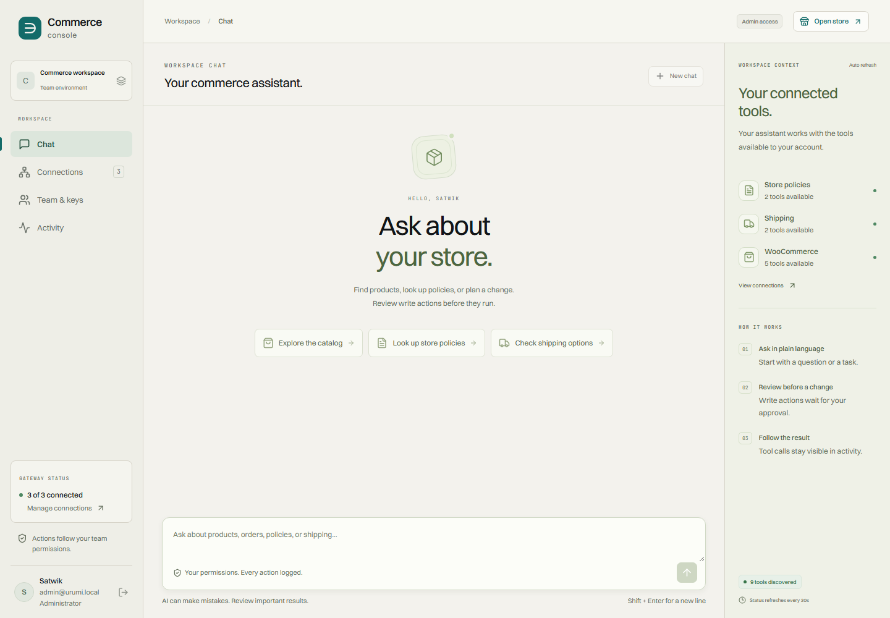

# Commerce console

A team MCP gateway for a real WooCommerce store. Administrators connect tools once; members use one endpoint or the dashboard chat with their own identity and permissions.

Built for the Urumi AI engineering assignment. This is an independent project, with visual cues from Urumi's public site. React and TypeScript power the dashboard; Python, FastAPI and the official MCP SDK power the gateway. All application services run in Kubernetes.



## What is included

- A persistent WordPress and WooCommerce storefront with cash-on-delivery checkout.
- Three original Streamable HTTP MCP servers: commerce, store policies and shipping quotes. The commerce server implements all five required product and order tools.
- A dynamic MCP registry with collision-safe tool names, cached discovery, isolated timeouts and credential storage in Kubernetes Secrets.
- Invitations, administrator and member roles, individually hashed API keys, immediate revocation, and per-tool role permissions.
- Gemini chat that calls the real gateway as the signed-in user, shows tool results, and requires confirmation before a write.
- An attributable audit trail, SSRF protection, network isolation and least-privilege Kubernetes RBAC.
- One Helm chart with local and production values, repeatable bootstrap, backup scripts, and CI checks.

The scope is one store and one gateway replica. The differentiators are **tool permissions** and **security hardening**. Local execution is free apart from the resources on your computer. Chat uses `gemini-3.1-flash-lite`, whose text input and output are available on [Google's free tier](https://ai.google.dev/gemini-api/docs/pricing#gemini-3.1-flash-lite), subject to your account's quota. Use a free-tier API project; the application does not enable billing or switch keys when quota runs out. There is no paid VPS dependency.

## Local setup on Windows

Prerequisites: Docker Desktop running Linux containers, PowerShell 7 (`pwsh`), Git, `kubectl`, Python 3.12 and [uv](https://docs.astral.sh/uv/getting-started/installation/). Allocate at least 8 GB to Docker; the project node is capped at 6 GB. Ports 8080 and 8443 must be available. Node.js 24 is needed for frontend development outside Docker and the MCP Inspector checks. Internet access is required for the initial image, dependency and font downloads. On a 16 GB computer, run builds and browser verification sequentially, with sufficient free host memory.

From the repository root:

```powershell
uv sync --frozen
New-Item -ItemType Directory -Force .secrets | Out-Null
notepad .secrets/gemini-api-key.txt
# Save only your Gemini API key, then close the editor.
pwsh -File scripts/bootstrap.ps1
```

The script verifies and installs Helm and k3d under `.tools`, starts the dedicated `urumi-commerce` cluster, generates random credentials in `.secrets/development.json`, creates Kubernetes Secrets, builds and imports three images, and installs the chart. Initial setup takes several minutes. Re-running it preserves the existing store and gateway data. It does not replace registry credentials that administrators have changed.

Open [the console](http://console.localhost:8080) and [the storefront](http://store.localhost:8080). The `.localhost` names resolve to loopback; k3d maps port 8080 to the cluster ingress. No Windows hosts-file change is needed. WordPress admin is at [the store admin page](http://store.localhost:8080/wp-admin/).

Open `.secrets/development.json` in your editor to find `admin_email`, `admin_password`, `wordpress_admin_user` and `wordpress_admin_password`. Keep this file private. The bootstrap script restricts its directory to your Windows account. It never prints passwords. A missing Gemini key leaves management and MCP working, with an explicit unavailable-chat notice.

## Use the system

1. Sign in as administrator. Connections should show three connected servers and their discovered tools.
2. In Chat, ask: `Create a product called Field notebook priced at INR 249, SKU FIELD-NOTEBOOK-01.` Review the tool arguments and approve. Inspect the returned product and open the store.
3. Add the product to the cart and check out with an Indian test address, such as Bengaluru, Karnataka, 560038. Choose Cash on delivery. This is a demo store: no money or shipment is processed.
4. Confirm the order under WooCommerce > Orders in WordPress admin. Ask chat: `What orders came in today?` The store timezone is Asia/Kolkata.
5. Open Team & keys, invite a member, and copy the invitation link. There is no email service. Accepting the invitation signs in as that invited account, replacing any existing session in the same browser profile. Use a separate browser profile to keep administrator and member sessions open at the same time.
6. As the member, generate an API key and connect an external MCP client using only the URL and bearer key. See [external client instructions](docs/external-clients.md).
7. Ask: `Read the shipping policy and quote delivery for an INR 1700 order to Karnataka, India. Use both tools.` This requires two separate upstreams.
8. Revoke that key as administrator. Its next request fails, including on an already initialized MCP transport. Disable an upstream and refresh the client's tool list: its tools disappear and stale direct calls are rejected.

Members can read products, orders, policies and shipping estimates. Writes and registry/team administration require an administrator. Newly discovered tools default to administrator-only until an administrator marks them as read tools. Chat confirmations are bound to a user session, expire after five minutes, and can be used only once.

The sample shipping table charges INR 59 for standard regions or INR 99 for the documented remote states, plus INR 20 per additional 0.5 kg. Orders of INR 1500 or more ship free. The storefront implements the same sample rules. The quote service is not a carrier integration.

## Development and verification

```powershell
uv run pytest -q
uv run ruff check backend upstreams tests scripts examples
Set-Location dashboard
npm ci
npm run build
Set-Location ..
.tools/helm.exe lint deploy/chart -f deploy/values-local.yaml
.tools/helm.exe lint deploy/chart -f deploy/values-prod.yaml
```

Integration tests require the running cluster and local private credentials:

```powershell
uv run python -m tests.acceptance --chat
uv run playwright install chromium
uv run python -m tests.browser_ui
uv run python -m tests.browser_invitation
uv run python -m tests.browser_visual
uv run python -m tests.browser_acceptance
```

The acceptance harness creates a real second user, calls all three upstreams over MCP, tests hidden writes, disabled servers, SSRF, revocation and audit isolation. `--chat` sends a live Gemini request and consumes quota. The checkout browser harness creates a real product and test order. UI regression tests use real sign-in with browser response fixtures for reproducible failure and race conditions, without calling Gemini. Visual checks inspect the deployed pages at widths from 320 to 1440 px. Evidence stays private under `.runtime`; test keys are revoked during cleanup. See [verification evidence](docs/verification.md) and the [audit record](docs/audit.md) for results and limitations.

[External verification](docs/external-clients.md) uses MCP Inspector as the third-party protocol client and an independent SDK agent for the real natural-language prompt. The [sanitized result](docs/assets/external-agent-evidence.json) records successful calls across all three upstreams for order 25; Gemini CLI is not a claimed passing client.

After source changes, rebuild, import and roll out the same chart:

```powershell
pwsh -File scripts/build-images.ps1
pwsh -File scripts/deploy.ps1
```

For frontend-only development, run `npm run dev` in `dashboard`. Vite proxies API requests to the local console ingress. Run the complete deployment for the final demonstration.

Stop without deleting data:

```powershell
pwsh -File scripts/stop.ps1
```

Run bootstrap again to resume. `scripts/uninstall.ps1` documents deliberate removal; do not delete persistent volumes if you intend to keep orders.

## Deployment and design

Use the same chart on a k3s VPS with different image references, public domains, HTTPS, storage and Secret values. See [operations and production setup](docs/operations.md) for exact steps, backup, upgrade and rollback. Production values are a template, not a claim that a public VPS is already deployed. No infrastructure purchase is required for the local submission.

| Area | Source |
| --- | --- |
| Gateway, sessions, permissions, chat | `backend/` |
| WooCommerce adapter and MCP servers | `upstreams/` |
| React dashboard | `dashboard/` |
| Store image and repeatable seed | `docker/wordpress/` |
| Helm resources and environment values | `deploy/` |
| Cluster and release commands | `scripts/` |
| Unit, protocol and deployed acceptance checks | `tests/` |

Read the [system design and tradeoffs](docs/system-design.md), [threat model](docs/threat-model.md), [visual references and font licensing](docs/brand-notes.md), and [demo walkthrough](docs/demo.md). Credentials are never included in these documents or client examples.

## Deliberate limits

This is a production-shaped single-node demonstration, not a claim of high availability. Kubernetes Secrets require cluster encryption at rest and protected backups in production. Local traffic uses HTTP on loopback; public deployment requires TLS and secure cookies. Rate limiting is per process. Schema migrations are forward-only until an explicit rollback migration exists, and Helm rollback does not rewind databases. The model is an external service with quota and latency limits. Conversation content remains in the browser tab; audit records persist in PostgreSQL.

The repository is private at the owner's request. Give reviewers repository access before submitting its link. Record your own explanation with the [demo guide](docs/demo.md), and review any recording before sharing so that API keys, passwords and invitation tokens stay private. A public deployment and a narrated submission video are separate deliverables, not implied by the local checks.
