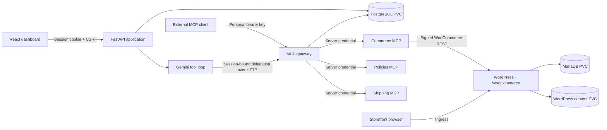

# System design and tradeoffs

Commerce Console is a single-team WooCommerce operations workspace. It demonstrates a complete MCP gateway on Kubernetes with independently failing upstreams. It is an internship submission, not an official Urumi product.

## Components

The React dashboard is served as a static application. FastAPI contains the identity, registry, gateway, chat and audit modules in one deployment. PostgreSQL stores users, hashed keys, sessions, invitations, server metadata, tool catalogues, permissions, pending confirmations and audit records. The store runs WordPress with WooCommerce and its own MariaDB database. WordPress content, MariaDB and PostgreSQL each have persistent volumes.

Three independent Python processes expose Streamable HTTP MCP: WooCommerce, store policies and shipping estimates. The last two use versioned sample business rules. They are deliberately small services with real tool calls, not claims of live carrier or policy-provider integrations. WooCommerce owns products, checkout, prices and orders. Its adapter uses the WooCommerce REST API instead of bypassing application rules with SQL.

The public ingress hosts are the dashboard and storefront. `/api` and `/mcp` on the console host route to FastAPI. Upstreams and databases have only ClusterIP services. Kubernetes NetworkPolicies and a separate gateway-to-upstream bearer credential prevent ordinary cluster workloads from using the MCP services.

## One tool execution path

An external client sends its personal API key to `/mcp`. Middleware authenticates every request against the database, including requests on an existing MCP transport. The handler resolves the public tool alias, checks the server is enabled, applies the user's role, validates the JSON arguments and calls the original tool through the official Python SDK.

Dashboard chat uses a short-lived, signed delegation token bound to the verified dashboard session. The gateway checks that session and the user's current role for each delegated call. Browser-supplied user IDs never establish identity. The chat module uses an actual HTTP MCP client for execution, so the same gateway authorization and audit code applies. The LLM and browser never receive upstream credentials.

The chat loop disables automatic SDK function execution. It presents permitted tools, receives function calls, executes read operations through MCP and supplies results back to the model. Mutations pause for a one-use confirmation bound to the user and session. Calls bind the intended tool to its upstream revision, destination, schema and permissions. The gateway checks that binding and current authority again after waiting for capacity and completing the upstream handshake. Automatic chat calls also require the tool to remain read-only. A changed connection or permission requires a fresh proposal. A bounded number of rounds, calls, output bytes and concurrent requests limits resource use.

## Discovery, routing and failures

Public tool names combine an immutable server slug, a readable original tool name and a short hash of the original name. Discovery rejects a catalogue if two original names still produce the same alias. The mapping is resolved explicitly; the gateway does not trust a client-supplied destination URL. Aliases fit within 60 characters. The policies and shipping services both expose `search`, providing a real collision example. JSON Schema validation has no remote or filesystem reference resolver; only in-document references are permitted.

Each upstream's tool catalogue is refreshed independently under a timeout. Tool listing reads the stored catalogues and applies live enabled and permission settings, so it does not wait for a dead upstream. A failed refresh retains the last known catalogue and marks the server Unreachable. Calls return clear failures and other services continue working. Disabled servers disappear from discovery immediately. Clients that cache their tool list need a refresh; direct calls using stale names are still rejected. The SDK advertises zero cache TTL. This implementation does not claim push notifications for every legacy client.

Execution has per-upstream concurrency limits and an overall deadline. Writes are not automatically retried. A timeout can mean the store committed a mutation before the response was lost, so callers must reconcile state before retrying. Supplying a unique SKU makes product creation easier to reconcile, but is not a claim of exactly-once delivery.

Every authenticated tool attempt creates an audit row before dispatch and finishes it with duration and outcome. Denied calls and recognizable revoked-key attempts retain user attribution. Audit records contain server/tool snapshots, not customer addresses or raw order payloads. A process crash can leave a pending record; it must not be reported as success.

## Credentials and Kubernetes access

Random user API keys are shown once and stored as SHA-256 hashes. Their entropy makes a fast hash appropriate; human passwords use Argon2. Dashboard sessions are opaque random tokens with hashed storage, HttpOnly cookies and CSRF protection.

Accepting an invitation signs in as the account and role recorded on that invitation. Acceptance and password login revoke the browser session they replace before issuing a fresh cookie. Other browser profiles retain their independent sessions. Tabs within one profile refresh their identity and discard the previous account's workspace state when an account changes.

Bootstrap configuration lives in Kubernetes Secrets created by a setup script. Dynamically registered upstream credentials live in a dedicated mutable Secret; PostgreSQL stores references. Each bundled upstream reads its own service token from the application Secret. Editing or deleting the gateway's credential copy cannot change that service's authentication or prevent its pod from starting. The backend service account has get and patch rights on the mutable credential Secret only. It cannot enumerate other Secrets or create workloads. Kubernetes does not offer per-field authorization inside one Secret, so the gateway can read all registered upstream credentials. This is the intended trust boundary for one team.

Helm references existing Secrets instead of including credential values in release manifests. The setup script does not replace existing runtime credentials on a normal redeployment. K3s secret encryption is enabled at cluster creation. This protects datastore files at rest, not against a cluster administrator or a compromised gateway process.

The first application start seeds the administrator and three bundled connections, then stores a bootstrap marker in PostgreSQL. Subsequent starts preserve registry deletions as well as edits and disabled states. The migration for an existing installation records that initialization has already happened, preventing an upgrade from silently restoring a deleted connection.

## Store correctness

The adapter uses OAuth 1.0 HMAC-SHA256 for internal HTTP requests, with credentials in the Authorization header. WooCommerce signs against its public home URL, so transport and signing origins are configured separately. The consumer secret is not sent in a URL. In production, external ingress uses TLS. The internal network remains a cluster trust boundary; request signing is not payload encryption.

Prices remain decimal strings and Python Decimal values. The sample store uses INR and Asia/Kolkata. Today's order bounds use the configured store timezone. Lists expose page counts so callers can request further pages. Order tools project only the fields needed for operations and shipping regions.

## Local and production

Local k3d runs K3s with Traefik, local-path storage and an embedded NetworkPolicy controller. The same Helm chart accepts production hosts, TLS Secret references, storage class, sizes, image tags and resource settings. Production deployment uses images pushed to a registry accessible to the target k3s machine. The public VPS deployment is not implied by local verification.

One replica per component is intentional. PostgreSQL and MariaDB are not HA, local-path volumes are node-local, in-process rate limits are not distributed, and the gateway is not horizontally scaled. These are documented limits of a small single-node deployment. Redis, queues, a service mesh and a custom operator would not improve the required demonstration enough to justify their operational cost.

Upgrades use versioned images and Helm. Application rollback is distinct from database rollback. Back up the databases and WordPress content before an incompatible migration. Do not assume `helm rollback` restores persistent data.

## References

- [MCP Python SDK](https://py.sdk.modelcontextprotocol.io/)
- [WooCommerce REST API](https://developer.woocommerce.com/docs/apis/rest-api/)
- [K3s networking and policy enforcement](https://docs.k3s.io/networking/networking-services)
- [K3s Secret encryption](https://docs.k3s.io/security/secrets-encryption)
- [Urumi public engineering practices](https://github.com/UrumiAI/otta.sh/blob/main/DEVELOPMENT.md)
