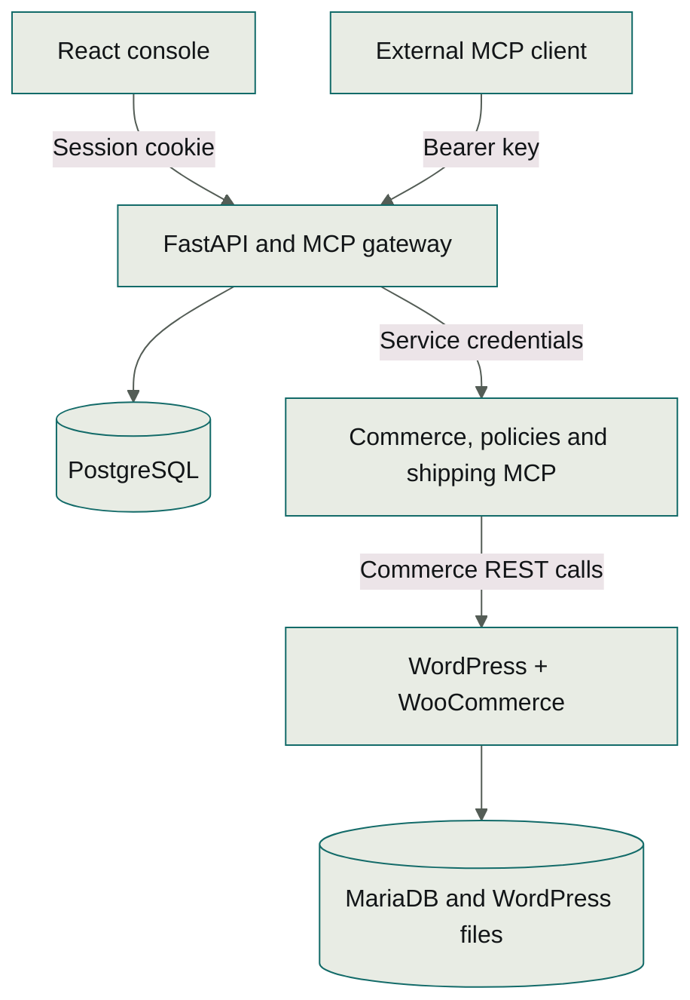

# Architecture

Harbor connects one team to a WooCommerce store through a shared Model Context Protocol (MCP) gateway. People use dashboard chat or an external MCP client. The gateway applies the same identity, tool permissions and audit rules to both paths.

## Technology stack

| Layer | Technology and responsibility |
| --- | --- |
| Console | React 19, TypeScript and Vite; browser sessions, connection management, chat and Activity |
| Application | Python 3.12 and FastAPI; identity, registry, chat orchestration and management API |
| MCP | Official Python SDK; Streamable HTTP gateway and three separate upstream services |
| Chat | Google Gen AI SDK and Gemini; tool selection and response generation |
| Application data | PostgreSQL, SQLAlchemy and Alembic migrations |
| Store | WordPress, WooCommerce, PHP and MariaDB |
| Deployment | Docker images, Helm and K3s; k3d runs the local cluster |
| Documentation | MkDocs with Material; built as a static site |

Dependency lockfiles and container definitions record exact versions. See [development](development.md) for the source map and [deployment](operations.md) for runtime configuration.

## Components

An upstream is a connected MCP service. The gateway is the shared entry point that authenticates clients, applies permissions and routes their calls.

The diagram groups the three MCP upstreams for readability; each runs independently. Chat calls Gemini from FastAPI and executes tools through the gateway. Storefront browsers connect directly to WordPress through ingress.

The React dashboard is served as a static application. FastAPI contains the identity, registry, gateway, chat and audit modules in one deployment. PostgreSQL stores users, hashed keys, sessions, invitations, server metadata, tool catalogues, permissions, pending confirmations and audit records. The store runs WordPress with WooCommerce and its own MariaDB database. WordPress content, MariaDB and PostgreSQL each have persistent volumes.

Three independent Python processes expose Streamable HTTP MCP: WooCommerce, store policies and shipping estimates. The last two use versioned sample business rules. They return sample rules and estimates; neither connects to a live carrier or policy provider. WooCommerce owns products, checkout, prices and orders. Its adapter uses the WooCommerce REST API instead of bypassing application rules with SQL.

The public ingress hosts are the dashboard and storefront. `/api` and `/mcp` on the console host route to FastAPI. Upstreams and databases have only ClusterIP services. Kubernetes NetworkPolicies and a separate gateway-to-upstream bearer credential prevent ordinary cluster workloads from using the MCP services.

## One tool execution path

An external client sends its personal API key to `/mcp`. Middleware authenticates every request against the database, including requests on an existing MCP transport. The handler resolves the public tool alias, checks the server is enabled, applies the user's role, validates the JSON arguments and calls the original tool through the official Python SDK.

Dashboard chat uses a short-lived, signed delegation token bound to the verified dashboard session. The gateway checks that session and the user's current role for each delegated call. Browser-supplied user IDs never establish identity. The chat module uses an HTTP MCP client for execution, so the same gateway authorization and audit code applies. The LLM and browser never receive upstream credentials.

The chat loop disables automatic SDK function execution. It presents permitted tools, receives function calls, executes read operations through MCP and supplies results back to the model. Mutations pause for a one-use confirmation bound to the user and session. Calls bind the intended tool to its upstream revision, destination, schema and permissions. The gateway checks that binding and current authority again after waiting for capacity and completing the upstream handshake. Automatic chat calls also require the tool to remain read-only. A changed connection or permission requires a fresh proposal. A bounded number of rounds, calls, output bytes and concurrent requests limits resource use.

The confirmation flow is part of dashboard chat. External administrator clients may invoke write tools directly. Member keys remain limited to tools the administrator has classified as read operations.

### Large tool catalogs in chat

Small catalogs go directly to Gemini. If the permitted catalog exceeds 40 tools or 48 KiB of serialized function declarations, chat starts with one internal `harbor_search_tools` function. These are Harbor's application budgets, not Gemini's advertised limits.

Search ranks the permitted tool names, server names and descriptions locally. It returns at most five matches and enables their complete schemas for the next model round. A new search replaces the selection; pagination and query refinement let the model reach later tools without accumulating the whole catalog. A schema that cannot fit is reported explicitly and remains unavailable in chat. It is never truncated to make execution possible.

Every selected schema is bound to its upstream revision, destination and permissions. Chat refreshes the identity before discovery and execution, rejects changed targets, and keeps the same write-confirmation flow. Search requests share the existing 12-function-call and eight-round limits. Discovery inspects a catalog; only actual gateway calls create tool-execution audit records.

External MCP clients still receive the ordinary tool list, paginated at 100 entries, and invoke the original public aliases. They control their own model context. The standalone reference agent follows all pages but reports an explicit error above its smaller 40-tool/48-KiB model budget.

## Discovery, routing and failures

Public tool names combine an immutable server slug, a readable original tool name and a short hash of the original name. Discovery rejects a catalogue if two original names still produce the same alias. The mapping is resolved explicitly; the gateway does not trust a client-supplied destination URL. Aliases fit within 60 characters. The policies and shipping services both expose `search`, so aliases must distinguish tools with identical original names. JSON Schema validation has no remote or filesystem reference resolver; only in-document references are permitted.

Each upstream's tool catalogue is refreshed independently under a timeout. Tool listing reads the stored catalogues and applies live enabled and permission settings, so it does not wait for a dead upstream. A failed refresh retains the last known catalogue and marks the server Unreachable. Calls return clear failures and other services continue working. Disabled servers disappear from discovery immediately. Clients that cache their tool list need a refresh; direct calls using stale names are still rejected. The SDK advertises zero cache TTL. Clients must refresh discovery after a connection or permission change rather than relying on push notifications.

Execution has per-upstream concurrency limits and an overall deadline. Untrusted schema work runs in one reusable subprocess. Starting the process and importing its validator have a separate five-second readiness limit; each untrusted validation operation retains a two-second execution deadline. Timeout or cancellation kills and reaps the worker. Input is capped at 512 KiB, 64 nesting levels and 20,000 JSON nodes. Linux deployments also restrict the worker's address space. Startup, queueing and execution remain subject to the surrounding tool or discovery deadline, and ordinary API requests do not wait on the worker.

Writes are not automatically retried. Any failure after write dispatch can mean the store committed a mutation before the response was usable, so the response and audit record advise reconciling state before retrying. A unique SKU helps reconcile product creation; exactly-once delivery is not guaranteed.

Password hashing and verification share two non-queueing slots. Each Argon2 operation retains its 64 MiB memory cost; excess requests receive 503 with Retry-After instead of allocating another hash. Rate-limit bucket updates are synchronized across authentication threads. The limits keep concurrent hashing within the gateway's 512 MiB memory budget.

Every authenticated tool attempt creates an audit row before dispatch and finishes it with duration and outcome. Denied calls and recognizable revoked-key attempts retain user attribution. Audit records contain server/tool snapshots, not customer addresses or raw order payloads. A process crash can leave a pending record; it must not be reported as success.

## Credentials and Kubernetes access

Random user API keys are shown once and stored as SHA-256 hashes. Their entropy makes a fast hash appropriate; human passwords use Argon2. Dashboard sessions are opaque random tokens with hashed storage, HttpOnly cookies and CSRF protection.

Accepting an invitation signs in as the account and role recorded on that invitation. Acceptance and password login revoke the browser session they replace before issuing a fresh cookie. Other browser profiles retain their independent sessions. Tabs within one profile refresh their identity and discard the previous account's workspace state when an account changes.

Bootstrap configuration lives in Kubernetes Secrets created by a setup script. Dynamically registered upstream credentials live in a dedicated mutable Secret; PostgreSQL stores references. Each bundled upstream reads its own service token from the application Secret. Editing or deleting the gateway's credential copy cannot change that service's authentication or prevent its pod from starting. The backend service account has get and patch rights on the mutable credential Secret only. It cannot enumerate other Secrets or create workloads. Kubernetes does not offer per-field authorization inside one Secret, so the gateway can read all registered upstream credentials. This is the intended trust boundary for one team.

Helm references existing Secrets instead of including credential values in release manifests. The setup script does not replace existing runtime credentials on a normal redeployment. K3s secret encryption is enabled at cluster creation. This protects datastore files at rest, not against a cluster administrator or a compromised gateway process.

The first application start seeds the administrator and three bundled connections, then stores a bootstrap marker in PostgreSQL. Subsequent starts preserve registry deletions as well as edits and disabled states.

## Store correctness

The adapter uses OAuth 1.0 HMAC-SHA256 for internal HTTP requests, with credentials in the Authorization header. WooCommerce signs against its public home URL, so transport and signing origins are configured separately. The consumer secret is not sent in a URL. In production, external ingress uses TLS. The internal network remains a cluster trust boundary; request signing is not payload encryption.

Prices remain decimal strings and Python Decimal values. The sample store uses INR and Asia/Kolkata. Today's order bounds use the configured store timezone. Lists expose page counts so callers can request further pages. Order tools project only the fields needed for operations and shipping regions.

## Local and production

Local k3d runs K3s with Traefik, local-path storage and an embedded NetworkPolicy controller. The same Helm chart accepts production hosts, TLS Secret references, storage class, sizes, image tags and resource settings. Production images can come from an accessible private registry or be built and imported directly on a single k3s node. The [VPS deployment procedure](operations.md#vps-configuration) uses the latter approach.

Each component runs one replica. PostgreSQL and MariaDB have no high-availability configuration, local-path volumes stay on one node, rate limits are process-local, and the gateway is not horizontally scaled. Moving to multiple nodes requires changes to storage, session handling and rate limiting before increasing replicas.

Upgrades use versioned images and Helm. Application rollback is distinct from database rollback. Back up the databases and WordPress content before an incompatible migration. Do not assume `helm rollback` restores persistent data.

## References

- [MCP Python SDK](https://py.sdk.modelcontextprotocol.io/)
- [WooCommerce REST API](https://developer.woocommerce.com/docs/apis/rest-api/)
- [K3s networking and policy enforcement](https://docs.k3s.io/networking/networking-services)
- [K3s Secret encryption](https://docs.k3s.io/security/secrets-encryption)
